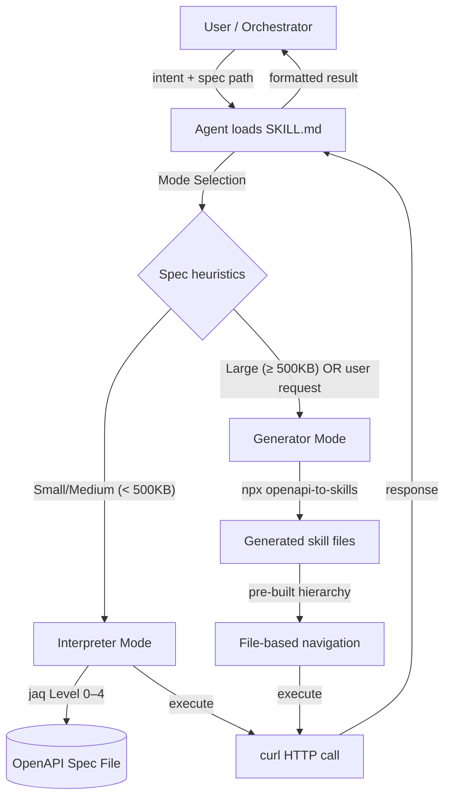

# Design: OpenAPI Meta-Skill

| Metadata | Details |
| :--- | :--- |
| **Status** | Draft |
| **Created** | 2026-03-03 |
| **Scope** | Full |
| **Feature Name** | openapi-meta-skill |

---

## 1. Executive Summary

`openapi-to-skills` proved that structuring OpenAPI docs into a hierarchical file tree dramatically reduces LLM context waste — but it requires an offline pre-processing step before any agent can act. `openapi-interpreter` removes that prerequisite: it delivers a meta-skill (a self-contained `SKILL.md` + reference guides) that teaches an agent to navigate *any* OpenAPI spec on demand using `jaq` and `curl`, with zero code generation and zero file system setup. For large or well-known APIs, the meta-skill can optionally delegate to `openapi-to-skills` to produce the same structured file tree, then navigate it via the proven `openapi-to-skills` hierarchy — giving operators the flexibility to choose offline pre-processing when context budgets are tight.

---

## 2. Requirements & Goals

### 2.1 Functional Requirements

| ID | Requirement |
| :- | :---------- |
| F-01 | Agent can discover all available API operations from a given OpenAPI spec file (JSON/YAML/TOML) without any pre-processing. |
| F-02 | Agent can filter and retrieve the exact parameters, request body schema, and security requirements for a specific operation. |
| F-03 | Agent can resolve `$ref` chains (inline, local, and cross-document after bundling) to understand nested schemas. |
| F-04 | Agent can construct a correctly shaped `curl` command, including path params, query params, headers, and request body. |
| F-05 | Agent can identify the applicable authentication scheme and prompt for missing credentials rather than executing anonymously. |
| F-06 | The system supports two modes — **Interpreter Mode** (dynamic, jaq-powered) and **Generator Mode** (delegate to `openapi-to-skills` + navigate generated files). |
| F-07 | The meta-skill can automatically select the appropriate mode based on spec complexity heuristics (file size, operation count). |
| F-08 | When `openapi-to-skills` output already exists, the meta-skill navigates those files directly without re-invoking the tool. |
| F-09 | All reference guides (`authentication.md`, `ref-resolver.md`, `request-builder.md`, `error-handling.md`) are read on demand — not pre-loaded into context. |

### 2.2 Non-Functional Goals

| ID | Goal |
| :- | :---- |
| NF-01 | **Minimal context burn**: Each progressive disclosure level adds ≤ 500 tokens to context. |
| NF-02 | **Format agnostic**: `jaq` handles `.json`, `.yaml`, `.yml`, and `.toml` natively; the agent issues identical commands regardless of source format. |
| NF-03 | **Framework agnostic**: The SKILL.md uses only universal agent capabilities — shell command execution and file reading. No special integrations or MCP dependencies. |
| NF-04 | **Composable**: The meta-skill can be composed with other skills (e.g., used as a sub-routine by a higher-level orchestration skill). |
| NF-05 | **Interpretability**: Every jaq command in the SKILL.md includes an inline comment explaining what it extracts. |
| NF-06 | **Graceful degradation**: If `jaq` is unavailable, the agent falls back to `python3 -c` one-liners for JSON, with a clear fallback path in the SKILL.md. |

### 2.3 Explicit Out-of-Scope

- Generating language-specific SDK clients (belongs to `openapi-to-skills` generator mode or other tools).
- Resolving external `$ref` URIs pointing to remote URLs at runtime (spec must be bundled first with `swagger-cli bundle`; this is documented as a pre-condition).
- Persistent state or session management between API calls.
- Retry logic or rate-limit handling (agent must implement these in their own workflow).

### 2.4 Assumptions

- `jaq` v1.x or later is available in the agent's shell environment. (Installation instructions are included in `README.md`.)
- `curl` is available in the agent's shell environment.
- The OpenAPI spec has already been bundled if it contains external `$ref` references. The meta-skill documents this pre-condition clearly.
- The agent runtime supports shell command execution.

---

## 3. Architecture Overview

### 3.1 System Context



### 3.2 Key Design Principles

1. **Progressive Disclosure** — The agent queries exactly what it needs for each reasoning step, never more. Borrowed from `openapi-to-skills`, but made fully dynamic.
2. **Hierarchy Parity** — Interpreter Mode produces the same conceptual navigation layers (`SKILL → resource → operation → schema`) as `openapi-to-skills`'s static output, so agents reason identically across both modes.
3. **Single Source of Truth** — The spec file itself (or its generated output) is always the authoritative source; the SKILL.md contains no API-specific knowledge.
4. **Transparent Toolchain** — Every shell command in SKILL.md is explicit, copy-pasteable, and annotated.

### 3.3 Existing Components to Reuse

| Component | Source | How Reused |
| :-------- | :----- | :--------- |
| `openapi-to-skills` CLI | `npmjs.com/package/openapi-to-skills` | Generator Mode delegates to `npx openapi-to-skills` for pre-processing. |
| `openapi-to-skills` template structure | `skill.md.eta`, `operation.md.eta`, `resource.md.eta`, `schema.md.eta` | The Interpreter Mode's Level hierarchy mirrors the navigation flow of these generated files exactly. |
| `swagger-cli bundle` | `npmjs.com/package/@apidevtools/swagger-cli` | Pre-condition for specs with external `$ref`. Documented in README. |
| `jaq` | `github.com/01mf02/jaq` | Runtime JSON/YAML/TOML querying. Replaces custom parsers. |

---

## 4. Detailed Design

### 4.1 Project Structure

```
openapi-interpreter/
├── SKILL.md                       ← Meta-skill entry point (agent instructions)
├── README.md                      ← Installation, quickstart, mode comparison
├── references/
│   ├── interpreter-mode.md        ← Full jaq command reference (Levels 0–4)
│   ├── generator-mode.md          ← How to invoke openapi-to-skills, then navigate output
│   ├── authentication.md          ← Per-scheme curl construction: apiKey, Bearer, OAuth2, Basic
│   ├── ref-resolver.md            ← $ref → jaq path translation algorithm
│   ├── request-builder.md         ← Body serialization, path/query param injection, content-type
│   └── error-handling.md          ← 4xx/5xx diagnostics + retry guidance
└── examples/
    ├── petstore/                  ← petstore.yaml + example conversations
    ├── github/                    ← Subset of GitHub REST API spec
    └── stripe/                    ← Subset of Stripe API spec
```

### 4.2 SKILL.md Logic Flow

The SKILL.md is the **only file the agent must load upfront**. It encodes the full decision tree for mode selection and progressive discovery. Its structure:

```
---
name: openapi-interpreter
description: Dynamically read and execute any OpenAPI spec without pre-processing.
  Use when the user has an OpenAPI spec file and wants to call an API.
---

# OpenAPI Interpreter

## Prerequisites Check
## Mode Selection
## [Interpreter Mode] Progressive Disclosure (Levels 0–4)
## [Generator Mode] Delegate + Navigate
## Execution (curl)
## References (load on demand)
```

**Key invariant:** The agent never reads more than one Level at a time. After each Level, it decides whether the answer is sufficient or whether the next Level is needed.

### 4.3 Progressive Disclosure Levels (Interpreter Mode)

The five levels mirror the conceptual hierarchy of `openapi-to-skills` output:

| Level | Concept | `openapi-to-skills` Equivalent | jaq Command Pattern |
| :---- | :------ | :----------------------------- | :------------------ |
| L0 | API metadata | `SKILL.md` header | `.info` + `.servers[0].url` |
| L1 | Resource index | `references/resources/*.md` list | `.tags` or path prefix groups |
| L2 | Operations in a resource | `references/resources/<tag>.md` | `.paths` filtered by tag |
| L3 | Single operation detail | `references/operations/<op>.md` | `.paths[path][method]` |
| L4 | Schema resolution | `references/schemas/<prefix>/<name>.md` | `.components.schemas[name]` |

**Level 0 — API Metadata:**
```bash
# Extract title, version, base URL, auth scheme names
jaq -r '{
  title: .info.title,
  version: .info.version,
  server: (.servers[0].url // "unknown"),
  auth_schemes: (.components.securitySchemes // {} | keys)
}' <spec_file>
```

**Level 1 — Resource Index:**
```bash
# List all tags with operation counts
jaq -r '.paths | to_entries[] | .value | to_entries[] |
  select(.value.tags?) | .value.tags[0]' <spec_file> |
  sort | uniq -c | sort -rn
```
*If no tags, fall back to grouping by the first path segment (mirrors `openapi-to-skills` `--group-by path` behavior).*

**Level 2 — Operations in a Resource:**
```bash
# Replace <TAG> with the target resource tag
jaq -r --arg tag "<TAG>" '
  .paths | to_entries[] |
  .key as $path |
  .value | to_entries[] |
  select(.value.tags[]? == $tag) |
  "\(.value.operationId // .key) \(.key) \($path)"
' <spec_file>
```

**Level 3 — Single Operation Detail:**
```bash
# Replace <PATH> and <METHOD> with target values, e.g. /pets and get
jaq --arg path "<PATH>" --arg method "<METHOD>" '
  .paths[$path][$method] |
  {
    summary,
    operationId,
    parameters: (.parameters // []),
    requestBody,
    security: (.security // []),
    responses: (.responses | to_entries | map({status: .key, description: .value.description}))
  }
' <spec_file>
```

**Level 4 — Schema Resolution:**
```bash
# Replace <SCHEMA_NAME> with the $ref target, e.g. "Pet"
jaq --arg name "<SCHEMA_NAME>" '.components.schemas[$name]' <spec_file>
```
*See `references/ref-resolver.md` for recursive $ref chains.*

### 4.4 Mode Selection Logic

The SKILL.md encodes the following decision logic:

```
IF (pre-generated openapi-to-skills output directory exists at <spec_dir>/):
  → Use pre-generated files directly (file-navigation path, zero jaq needed)
ELIF (spec file size > 500KB OR total operations > 200):
  → Recommend Generator Mode (offer to run `npx openapi-to-skills`)
  → If user declines, proceed with Interpreter Mode using L1/L2 path filtering
ELSE:
  → Interpreter Mode (default)
```

### 4.5 Generator Mode Workflow

When Generator Mode is selected, the agent executes:

```bash
# 1. Install (or use cached) openapi-to-skills
npx openapi-to-skills <spec_file> -o ./<skill_name>

# 2. Read the generated SKILL.md
cat ./<skill_name>/SKILL.md
```

After this, the agent follows the `openapi-to-skills` navigation flow exactly (read resource file → read operation file → read schema file). No further jaq is needed. See `references/generator-mode.md` for the full navigation protocol.

### 4.6 Authentication Handling

Authentication is a cross-cutting concern extracted to `references/authentication.md`. The core lookup:

```bash
# Extract all security scheme definitions
jaq '.components.securitySchemes' <spec_file>

# Extract security requirement for a specific operation
jaq --arg path "<PATH>" --arg method "<METHOD>" \
  '.paths[$path][$method].security // .security // []' <spec_file>
```

The reference file maps each scheme type to the corresponding curl flag:

| Scheme Type | curl Construction |
| :---------- | :---------------- |
| `http` / `bearer` | `-H "Authorization: Bearer $TOKEN"` |
| `apiKey` in header | `-H "<headerName>: $API_KEY"` |
| `apiKey` in query | `?<queryParam>=$API_KEY` |
| `http` / `basic` | `-u "$USERNAME:$PASSWORD"` |
| `oauth2` | `-H "Authorization: Bearer $ACCESS_TOKEN"` (token obtained separately) |

If required credentials are absent, the agent **must interrupt and request** them — never proceed anonymously for authenticated endpoints.

### 4.7 $ref Resolution Algorithm

Documented in `references/ref-resolver.md`. The algorithm:

1. Detect `$ref` string in output, e.g. `"$ref": "#/components/schemas/Pet"`.
2. Strip the leading `#/` prefix.
3. Split on `/` and convert to a `jaq` key path: `components.schemas["Pet"]`.
4. Run Level 4 query.
5. If the resolved schema contains further `$ref`s, repeat recursively (max depth: 10).
6. If a `$ref` points to an external file (`./common.yaml#/…`) — abort and instruct the user to bundle the spec first.

### 4.8 Request Builder

`references/request-builder.md` specifies how to translate parsed operation data into a valid curl command:

```
curl -s -X <METHOD> \
  "<BASE_URL><PATH_WITH_PARAMS_SUBSTITUTED>" \
  -H "Content-Type: <content_type>" \
  <AUTH_HEADERS> \
  -d '<JSON_BODY>'
```

Rules:
- Path parameters: substitute `{paramName}` in the path string with actual values.
- Query parameters: append `?key=value&key2=value2` to the URL.
- Request body: only include `-d` flag when the operation has a `requestBody`. Use `-d @-` for stdin piping if body is large.
- Do not include a body for `GET` / `DELETE` operations unless the spec explicitly defines `requestBody`.

### 4.9 Error Handling

`references/error-handling.md` covers:

| Scenario | Diagnosis | Recovery |
| :------- | :-------- | :------- |
| 400 Bad Request | Missing required param or wrong type | Re-read L3/L4, validate payload against schema |
| 401 Unauthorized | Missing/invalid auth token | See authentication.md, request credentials |
| 403 Forbidden | Valid token but insufficient scope | Re-read security.scopes in L3 |
| 404 Not Found | Wrong path or path param | Re-read L1/L2, verify route |
| 422 Unprocessable Entity | Schema validation failure | Re-read L4, correct field types/formats |
| 500 Server Error | Upstream server issue; not agent fault | Report to user; no retry by default |
| jaq parse error | Spec may be malformed or non-standard | Try python3 fallback; report malformed spec |

### 4.10 jaq Fallback (python3)

For environments where `jaq` is unavailable:

```bash
# Level 0 equivalent
python3 -c "
import sys, json
try:
    import yaml; spec = yaml.safe_load(sys.stdin)
except ImportError:
    spec = json.load(sys.stdin)
info = spec.get('info', {})
servers = spec.get('servers', [{}])
print(json.dumps({'title': info.get('title'), 'server': servers[0].get('url')}))
" < <spec_file>
```

The SKILL.md documents this fallback path under a "Prerequisites Check" section.

---

## 5. Verification & Testing Strategy

### 5.1 Manual Validation Matrix

For each example spec (`petstore`, `github`, `stripe`), verify:

| Check | Expected |
| :---- | :------- |
| L0 returns correct title + base URL | Per-spec known values |
| L1 lists all tags with correct op counts | Cross-check against spec |
| L2 for every tag lists correct operations | Cross-check against spec |
| L3 for a sampled operation returns correct parameters | Cross-check against spec |
| L4 resolves `$ref` correctly for all schema types | No missing fields |
| Authentication section matches spec's `securitySchemes` | Per-spec known values |
| curl command for a known-valid request returns HTTP 2xx | Petstore live endpoint |

### 5.2 Cross-Model Compliance Testing

Test the SKILL.md against these LLMs to verify instruction-following fidelity:

| Model | Expected Behavior |
| :---- | :---------------- |
| Claude 3.5 Sonnet | Full compliance — runs each Level in order, never skips to L4 prematurely |
| GPT-4o | Full compliance with minor prompt tuning |
| Gemini 1.5 Pro | Verify format-agnostic jaq commands handled correctly |

### 5.3 Edge Case Tests

- Spec with no tags (path-based grouping fallback)
- Spec with deep `$ref` chains (depth ≥ 5)
- Spec with `allOf` / `anyOf` / `oneOf` schema composition
- Spec with `oauth2` requiring scope-specific tokens
- Spec loaded from a URL via `jaq` + `curl` piping

### 5.4 Unit-Level Verification

Each `jaq` command in the SKILL.md and reference files must be individually run against all three example specs (petstore/json, petstore/yaml, stripe subset) and produce non-empty, correctly shaped output.

---

## 6. Implementation Plan

### Phase 1: Foundation

- [ ] Set up project repo structure (SKILL.md stub, README, references/ directory, examples/)
- [ ] Document prerequisites and mode comparison in README
- [ ] Prepare and commit example specs (petstore JSON, petstore YAML, stripe subset)

### Phase 2: Core — Interpreter Mode

- [ ] Write `references/interpreter-mode.md` with all Level 0–4 jaq commands + annotations
- [ ] Write `references/ref-resolver.md` with $ref resolution algorithm
- [ ] Write `references/authentication.md` with per-scheme curl mappings
- [ ] Write `references/request-builder.md` with URL and body construction rules
- [ ] Write `references/error-handling.md` with diagnostic table
- [ ] Compose SKILL.md with Prerequisites Check, Mode Selection, and Interpreter Mode sections

### Phase 3: Integration — Generator Mode

- [ ] Write `references/generator-mode.md` with openapi-to-skills invocation + navigation protocol
- [ ] Update SKILL.md Mode Selection section with generator mode decision logic and pre-generated file detection
- [ ] Validate full generator mode flow against a large spec (github subset)

### Phase 4: Polish

- [ ] Add petstore, github, stripe example conversations to `examples/`
- [ ] Write cross-model compliance test results to `examples/<model>/`
- [ ] Final review: ensure no unresolved placeholders in SKILL.md or any reference file
- [ ] Tag v0.1.0 release
